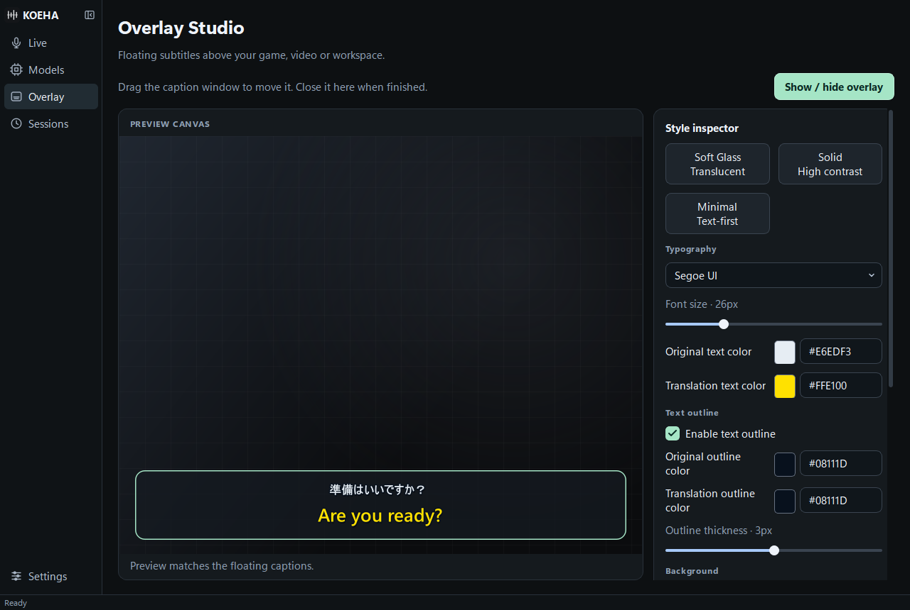

# Caption appearance

Open **Overlay** in the sidebar. The preview and floating window use the same text
renderer, so the selected colors, outlines, and spacing carry through to captions.
Click **Show / hide overlay** to compare them. While no session is running, opening
the overlay from this page displays the sample text.

| Control | Effect |
| --- | --- |
| Font and font size | Select an installed font and a size from 10 to 72 px. Original dialogue is smaller when translation is present. |
| Original / translation text color | Choose each line's fill color independently. |
| Enable text outline | Turn on the outline controls. |
| Original / translation outline color | Choose a separate stroke color for each line. |
| Outline thickness | Set the text stroke from 0 to 6 px. Zero removes the stroke. |
| Background color and opacity | Change the panel color or make it fully transparent. Text remains visible. |
| Border color and thickness | Style the panel's frame independently of the text outline. Zero hides the frame. |
| Corner radius | Adjust the panel corners from 0 to 24 px. |
| Show original line | Hide original dialogue when a translation is available. Original dialogue remains visible when there is no translation. |
| Text background shadow | Add a small shadow behind the glyphs for contrast. |

Click a color swatch to open the color picker. Changes preview while the picker is
open; **Cancel** restores the previous color. You can also enter `#RRGGBB` or
`#AARRGGBB` in the HEX field, then press Tab or Enter. In the eight-digit format,
the first two digits control transparency: `00` is transparent and `FF` is opaque.

**Soft Glass** uses a translucent panel. **Solid** uses an opaque panel. **Minimal**
removes the panel and turns on text outlines. Selecting a preset replaces its color
and background settings; font selection and size remain available for adjustment.
**Reset appearance** restores all caption appearance defaults.

Changes are saved automatically and restored at the next launch. The status at the
bottom of the inspector confirms when saving finishes. Appearance changes do not
restart recognition or apply uncommitted model selections from other pages.

In narrow windows the inspector moves below the preview. Scroll down to reach the
background and display controls.
